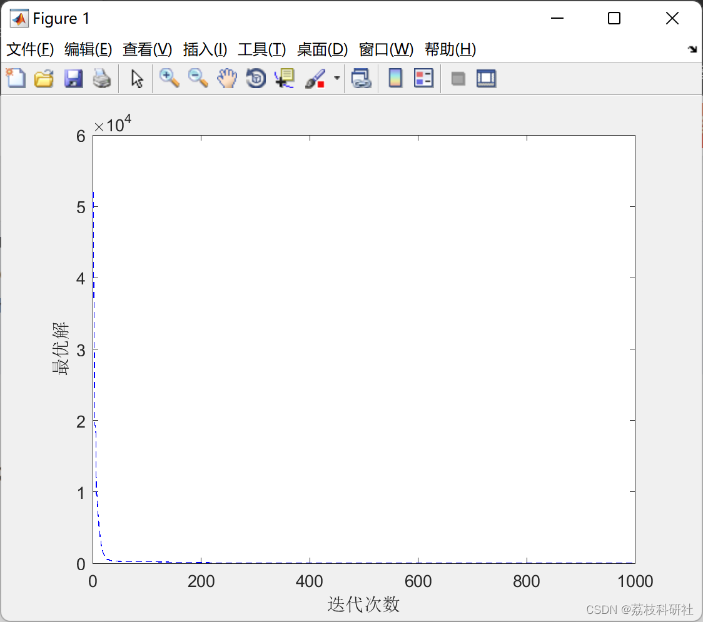

# Optimization Algorithm for Improving Teaching (Matlab Code Implementation)

The new proposed TLSBO (Teaching-Learning-Studying-Based Optimizer) enhances the global optimization performance of TLBO (Tunable Learning Rate Based Optimization) by adding a learning strategy. Each member uses information from another randomly selected individual to improve its position.
References study the performance of TLSBO in solving different standard real parameter benchmark functions and various nonlinear optimal power flow (OPF) problems. The results show that TLSBO converges faster and has higher quality compared to the original TLBO. It also has stronger capability to escape from local optima than the original TLBO.
Ebrahim Akbari, Mojtaba Ghasemi, Milad Gil, Abolfazl Rahimnejad, and S. Andrew Gadsden. "Optimal Power Flow via Teaching-Learning-Studying-Based Optimization Algorithm." Electric Power Components and Systems, October 2021, pp. 1-18. doi:10.1080/15325008.2021.1971331📚2 Run Results Edit
Part of the code:
function z = CostFunction(x)
D=length(x);
% [ps,D]=size(x);
% % % %   6.Shifted Rosenbrock's Function
% o=k(1:D);
% 
% x(1,1:D)=x(1,1:D)-(o(1,1:D))+1;
%
% z=sum(100.*(x(:,1:D-1).^2-x(:,2:D)).^2+(x(:,1:D-1)-1).^2,2);  
%   9.Shifted Rastrign's Function  
o=k(1:D);  
x(1,1:D)=x(1,1:D)-(o(1,1:D));  
z=sum(x.^2-10.*cos(2.*pi.*x)+10,2);  
end  
🌈3 Matlab code implementation
🎉4 References
​  

## Images

<!-- PAYMENT_BLOCK -->

## Get this dataset

- Payment link (Stripe): [Buy now](https://buy.stripe.com/3cs8yP7sY87d0vu9AB)
- Payment QR code: 

<!-- /PAYMENT_BLOCK -->
